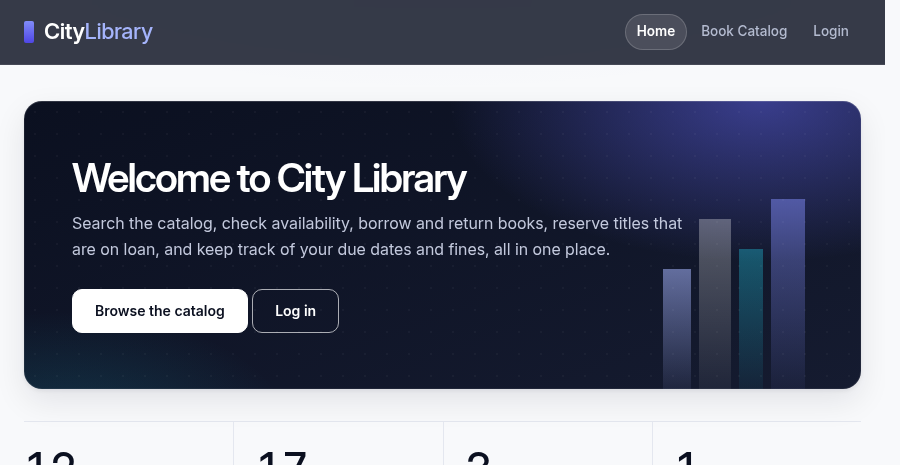
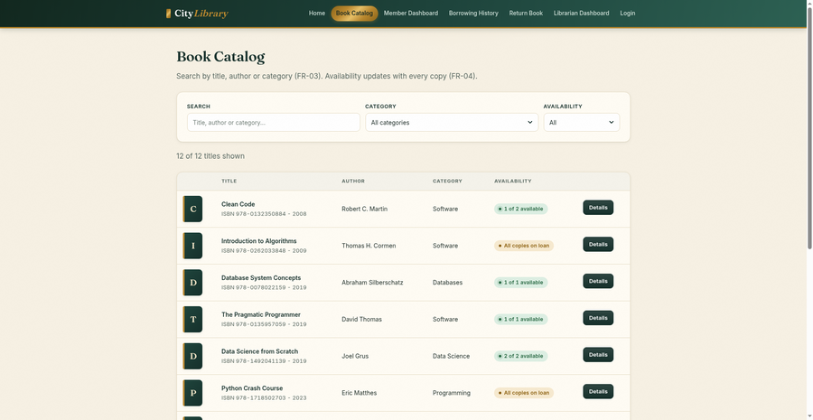
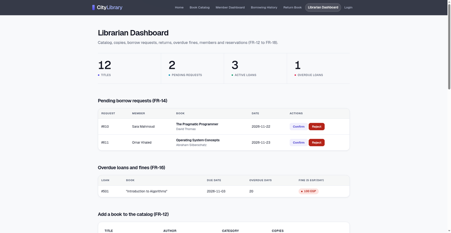

# Library Management System

**Live demo: https://hassan3443.github.io/library-management-system/**

| Home | Book Catalog | Librarian Dashboard |
| --- | --- | --- |
|  |  |  |

University project for **Information Systems Analysis and Design 1 (SA1)**: analysis, design and a working front-end demo of a Library Management System.

The system helps librarians organize books, manage members, and track borrowing and returns. Members can search the catalog, check availability, borrow and return books, reserve titles that are on loan, and follow their due dates and fines.

## Deliverables

| Deliverable | Location |
| --- | --- |
| Functional requirements (19) | [requirements/functional-requirements.md](requirements/functional-requirements.md) |
| Data Flow Diagram, Level 0 and Level 1 | [diagrams/dfd0.png](diagrams/dfd0.png), [diagrams/dfd1.png](diagrams/dfd1.png) |
| Class Diagram | [diagrams/class-diagram.png](diagrams/class-diagram.png) ([source](diagrams/class-diagram.puml)) |
| Activity Diagram | [diagrams/activity-diagram.png](diagrams/activity-diagram.png) ([source](diagrams/activity-diagram.puml)) |
| Sequence Diagram | [diagrams/sequence-diagram.png](diagrams/sequence-diagram.png) ([source](diagrams/sequence-diagram.puml)) |
| Use Case Diagram | [diagrams/use-case-diagram.png](diagrams/use-case-diagram.png) ([source](diagrams/use-case-diagram.puml)) |
| Front end (7 pages) | [docs/](docs/) |

The diagrams, the 19 functional requirements and the front end were cross-checked against each other. Known differences are listed in [diagrams/README.md](diagrams/README.md#implementation-notes) and [requirements/functional-requirements.md](requirements/functional-requirements.md#known-limits).

## Front end

Seven pages plus a login/register modal, static HTML/CSS/JS with mock data (no backend required, per the project brief). Demo actions that change state (borrow requests, reservations, loan confirmations, returns, fines and fine payments, catalog edits, suspension, login) persist in the browser via localStorage. The business logic is in `docs/js/logic.js` and has automated tests (below):

- **Home** - overview, live stats, feature map to the requirements
- **Book Catalog** - search by title/author/category/ISBN with live availability (FR-03, FR-04)
- **Book Details** - copies and their status, borrow request and reservation actions that are stored (FR-05, FR-09)
- **Member Dashboard** - current loans, due-date reminders, overdue notices, fines, reservations (FR-06, FR-10, FR-11)
- **Borrowing History** - every loan with return dates and late fines (FR-07)
- **Return Book** - pick an active loan, see the fine calculation, confirm the return: the loan is closed, the copy is freed or held for the reservation queue, and a late fine is recorded (FR-08, FR-15, FR-16)
- **Librarian Dashboard** (includes the Members section: list, suspend/reactivate, promote, remove; FR-17, FR-19) - pending borrow requests (confirm creates the loan, reject removes the request), unpaid fines with a record-payment action, overdue report with fines, full catalog management (add, update, remove books, register copies), member suspension, reservation queues (FR-12 to FR-18)
- **Login / Register** (modal on every page, FR-01, FR-02) - real credential check against the demo accounts in `docs/js/accounts.js` (static demo, so the check runs in the browser). Wrong password does not log in. Each role gets its own navigation and dashboard. New members can register.

**Demo accounts:** librarian `hassan@gmail.com` / `12345678`; members `sara.m@example.com` / `sara1234`, `omar.k@example.com` / `omar1234`, `mona.s@example.com` / `mona1234` (no loans, can be removed), `hassan.ashraf@example.com` / `member101`.

### Tests

```bash
node tests/logic.test.cjs
```

Runs the business logic (borrow, reserve, confirm, return, fines, book removal, seed data consistency) against fresh copies of the seed data. CI runs the same command on every push.

### Run it

Open `docs/index.html` in a browser, or serve the folder:

```bash
cd docs && python3 -m http.server 8000
# then open http://localhost:8000
```


## Business rules

- Loans run 14 days from librarian confirmation
- Overdue fine: 5 EGP per overdue day
- Members who are suspended, have an unpaid fine, or have 3 loans (active plus pending requests) cannot borrow; the demo enforces this on Book Details, when a request is submitted and again when a librarian confirms it
- Fines are paid at the desk; a librarian records the payment, which lifts the block
- A book with open loans, pending requests or reservations cannot be removed
- When a copy is returned and a queue exists, the copy is held (Reserved) for the first member in the queue

## Diagram sources

Diagrams are written as code: [PlantUML](https://plantuml.com/) (`diagrams/*.puml`) for UML diagrams and [Graphviz](https://graphviz.org/) (`diagrams/*.dot`) for the data flow diagrams, rendered to PNG for the report.

## License

MIT - see [LICENSE](LICENSE).

## Author

Hassan Ashraf - [github.com/Hassan3443](https://github.com/Hassan3443)
