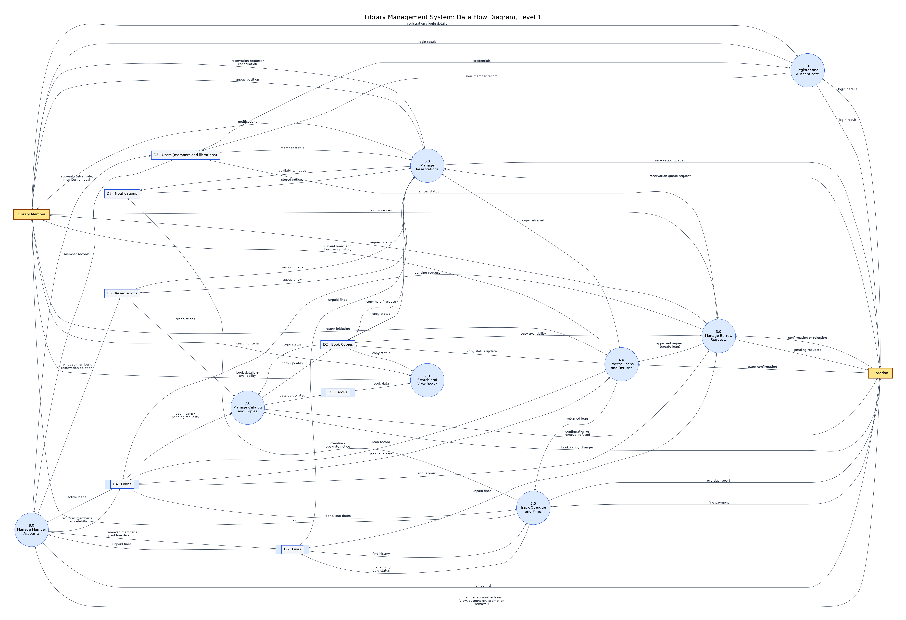
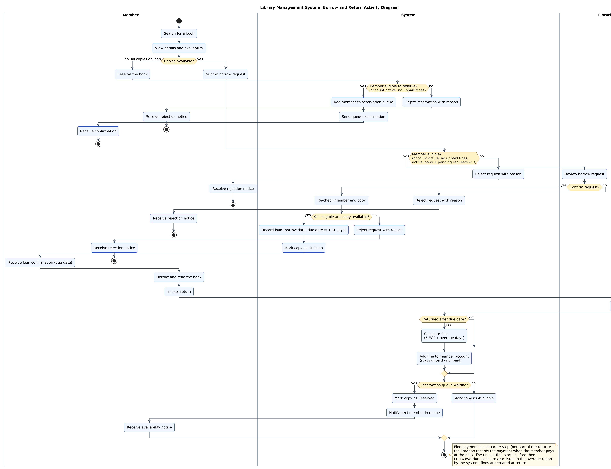

# Diagrams

All diagrams describe the same system and the same 19 functional requirements
(see [requirements/functional-requirements.md](../requirements/functional-requirements.md)).
Sources are diagrams-as-code: PlantUML (`.puml`) for UML diagrams and Graphviz (`.dot`) for the DFDs.
Each source has a rendered PNG next to it.

| Diagram | Covers | Source |
| --- | --- | --- |
| DFD Level 0 (context) | System boundary, 2 external entities (Library Member, Librarian), flows balanced with Level 1 | [dfd0.dot](dfd0.dot) |
| DFD Level 1 | 8 processes, 7 data stores, all 19 requirements | [dfd1.dot](dfd1.dot) |
| Class diagram | Every function FR-01 to FR-19 as an operation, tagged with its FR id | [class-diagram.puml](class-diagram.puml) |
| Use case diagram | 21 use cases covering all 19 requirements, include and extend relations | [use-case-diagram.puml](use-case-diagram.puml) |
| Activity diagram | Borrow and return workflow with swimlanes | [activity-diagram.puml](activity-diagram.puml) |
| Sequence diagram | Borrow request scenario (FR-05, FR-14) using class-diagram objects | [sequence-diagram.puml](sequence-diagram.puml) |

## DFD Level 0


## DFD Level 1


## Class Diagram


## Use Case Diagram


## Activity Diagram


## Sequence Diagram


## Implementation notes

Where the front end differs on purpose from the diagrams:

- Status names are written ON_LOAN, ACTIVE and so on in the class diagram and on-loan, active in the code. Same values, different spelling. `copyId` is a String (for example C2-1) in both.
- The sequence diagram creates a Loan in PENDING state at request time. The front end keeps a pending request as its own record and creates the Loan (ACTIVE) when the librarian confirms. REJECTED requests are removed instead of stored.
- A cancelled reservation is deleted in the front end, so ReservationStatus values WAITING, NOTIFIED, FULFILLED and CANCELLED are not all stored. The held copy (RESERVED) is tied to the book queue, not to one reservation.
- Fine keeps both a loan link and a member link in the class diagram. The code stores both ids on the fine.

- There is no separate Scheduler actor. The due-date notices (FR-11) and the overdue check (FR-16) are triggered by the system itself; the librarian sees the overdue report (UC16). Fines are created when the late book is returned.
- Promotion (FR-17) keeps the member record and sets the user role to LIBRARIAN (User.role in the class diagram, a promoted flag in the code).
- Passwords are stored as plain text in the browser (static demo with no backend), so the class diagram attribute is `password`.
- Rejecting a request is Librarian.rejectBorrowRequest and Loan.reject. Confirming first re-checks the member and the copy.
- Fine payment is a separate step after the return, not a condition for the copy to become available.
- Team note: requirements list owners Person 1 to Person 7. The instructor PDF asks for 2 requirements per member (16 for 8 members). Not changed here.

## Regenerate

```bash
cd diagrams
java -jar plantuml.jar -tpng *.puml      # needs Graphviz installed
dot -Tpng dfd0.dot -o dfd0.png
dot -Tpng dfd1.dot -o dfd1.png
```
