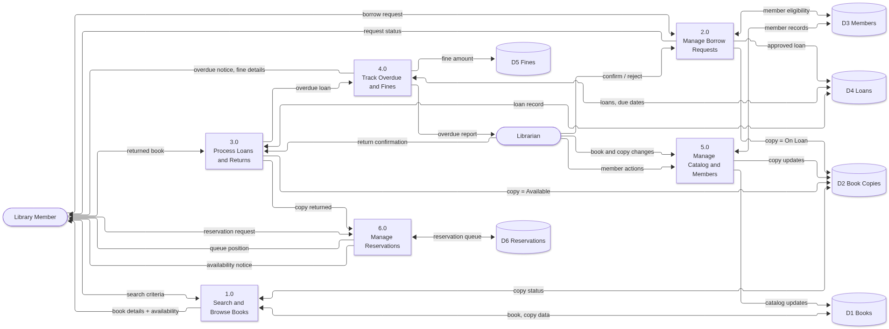

# Diagrams

All five diagrams describe the same system and the same 18 functional requirements
(see [requirements/functional-requirements.md](../requirements/functional-requirements.md)).
Each diagram has its Mermaid source (`.mmd`) and a rendered image (`.png`).

## Data Flow Diagram (DFD)
External entities (Member, Librarian), six processes (search/browse, borrow requests,
loans and returns, overdue and fines, catalog and member management, reservations)
and six data stores (D1 Books, D2 Book Copies, D3 Members, D4 Loans, D5 Fines, D6 Reservations).

## Class Diagram
Book, BookCopy, Member, Librarian, Loan, Fine and Reservation, with attributes,
methods and relationships (composition, association, multiplicity).

## Activity Diagram
The full borrow/return workflow: search, availability check, eligibility check,
librarian confirmation, loan recording, return processing, fine calculation and
reservation-queue notification.

## Sequence Diagram
The borrow scenario (FR-03 -> FR-05 -> FR-14) and the return scenario with the
overdue/fine alternative path, in chronological order between Member, Front End,
System, Data Store and Librarian.

## Use Case Diagram
Both actors and all 18 use cases, plus include/trigger relationships
(borrow includes viewing availability; processing a return triggers fine calculation;
reserving notifies the member).

