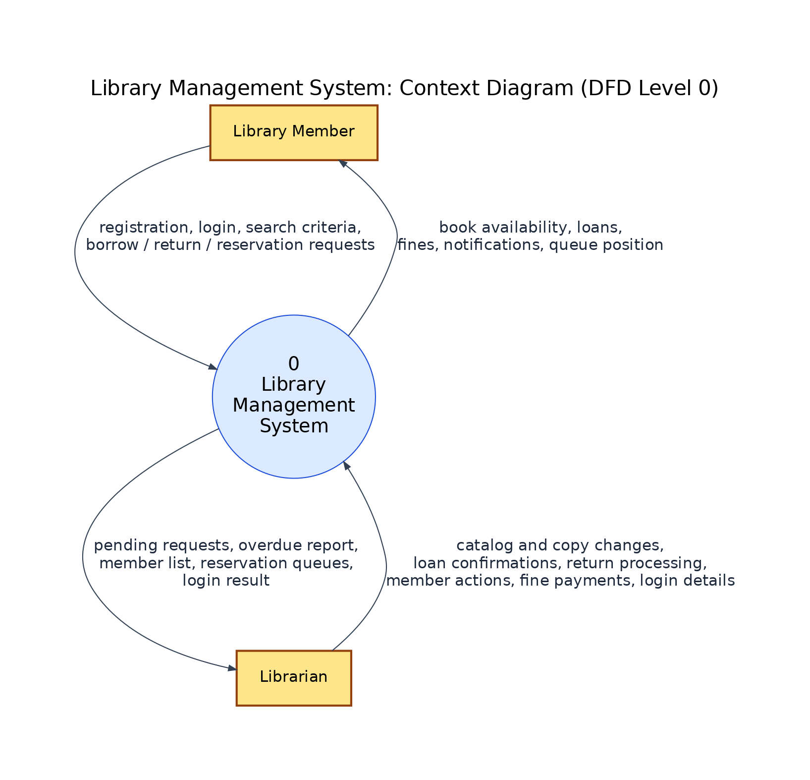
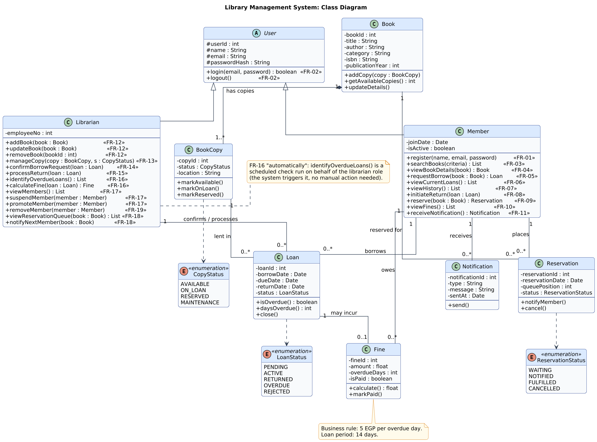
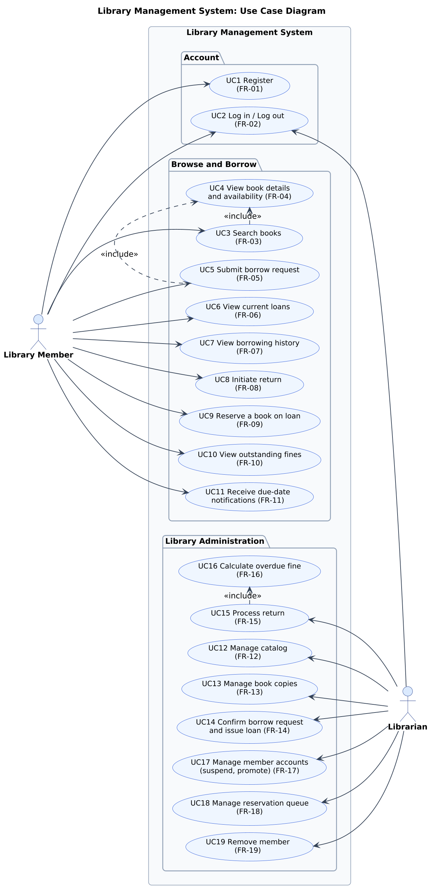
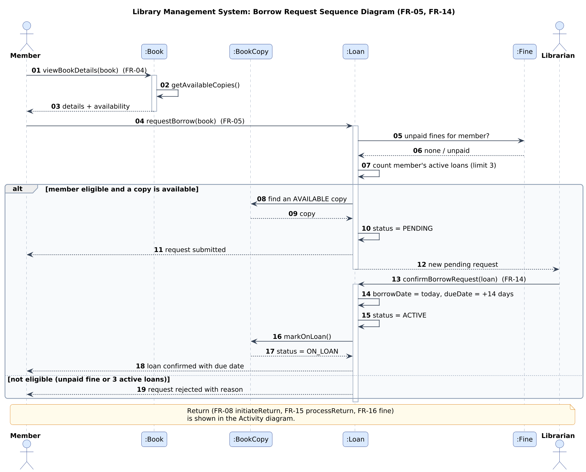

# Diagrams

All diagrams describe the same system and the same 19 functional requirements
(see [requirements/functional-requirements.md](../requirements/functional-requirements.md)).
Sources are diagrams-as-code: PlantUML (`.puml`) for UML diagrams and Graphviz (`.dot`) for the DFDs.
Each source has a rendered PNG next to it.

| Diagram | Covers | Source |
| --- | --- | --- |
| DFD Level 0 (context) | System boundary, 2 external entities | [dfd0.dot](dfd0.dot) |
| DFD Level 1 | 8 processes, 7 data stores, all 19 requirements | [dfd1.dot](dfd1.dot) |
| Class diagram | Every function FR-01 to FR-19 as an operation, tagged with its FR id | [class-diagram.puml](class-diagram.puml) |
| Use case diagram | All 19 use cases, include relations | [use-case-diagram.puml](use-case-diagram.puml) |
| Activity diagram | Borrow and return workflow with swimlanes | [activity-diagram.puml](activity-diagram.puml) |
| Sequence diagram | Borrow request scenario (FR-05, FR-14) using class-diagram objects | [sequence-diagram.puml](sequence-diagram.puml) |

## DFD Level 0


## DFD Level 1


## Class Diagram


## Use Case Diagram


## Activity Diagram


## Sequence Diagram


## Regenerate

```bash
cd diagrams
java -jar plantuml.jar -tpng *.puml      # needs Graphviz installed
dot -Tpng dfd0.dot -o dfd0.png
dot -Tpng dfd1.dot -o dfd1.png
```
